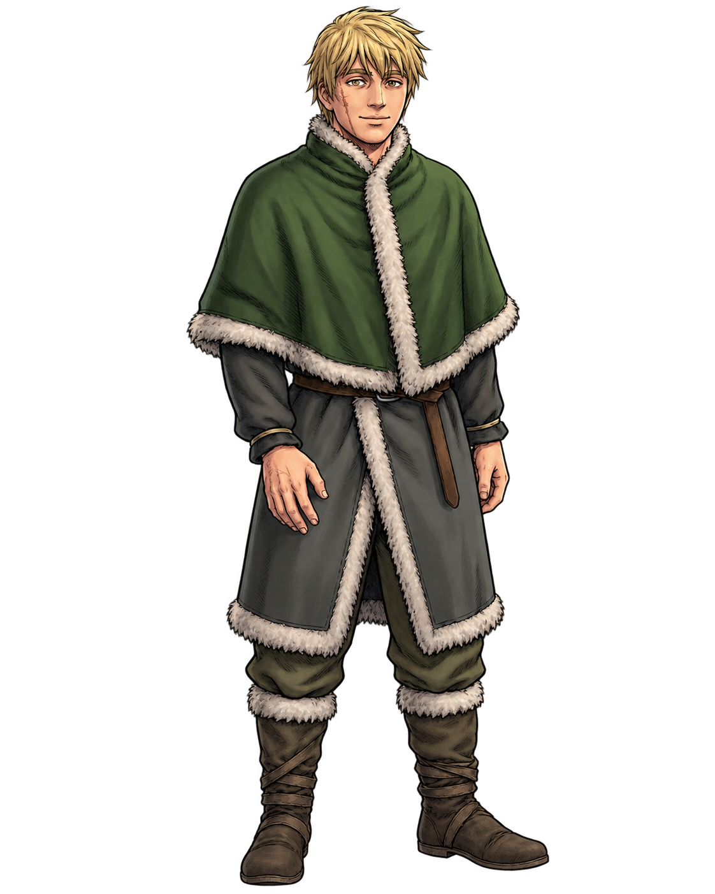
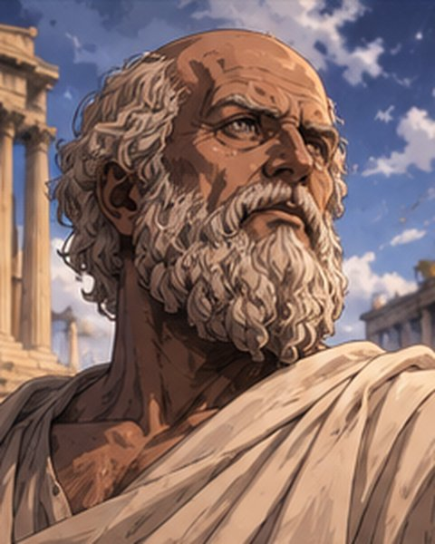
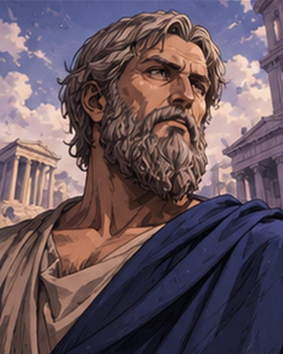
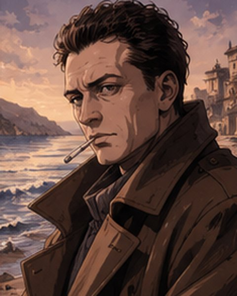
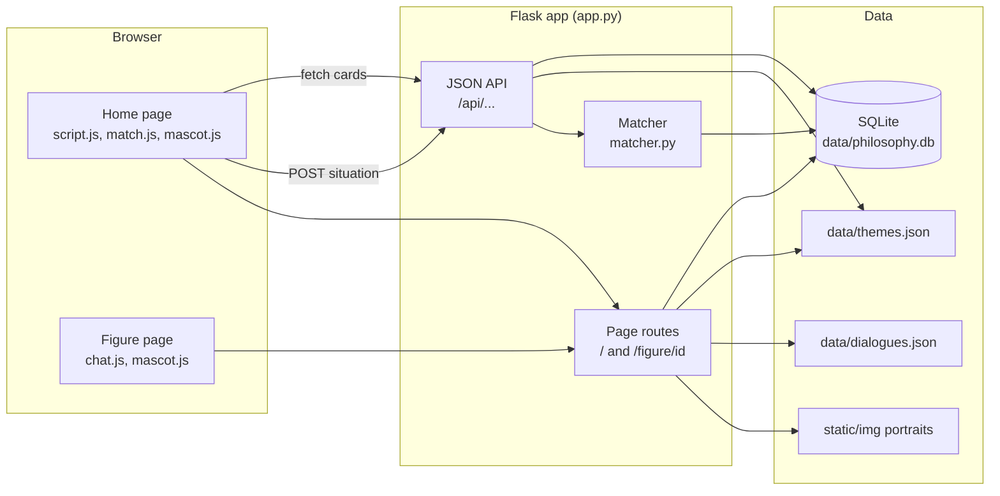
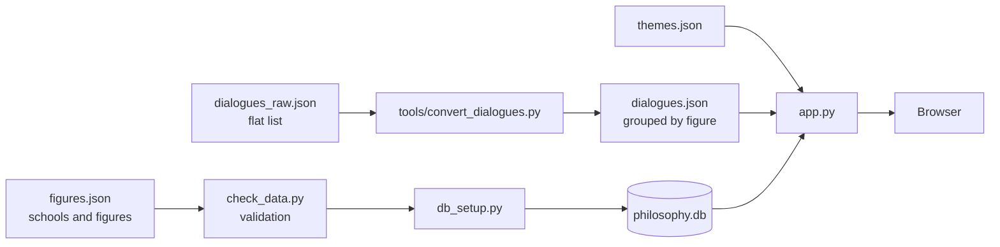
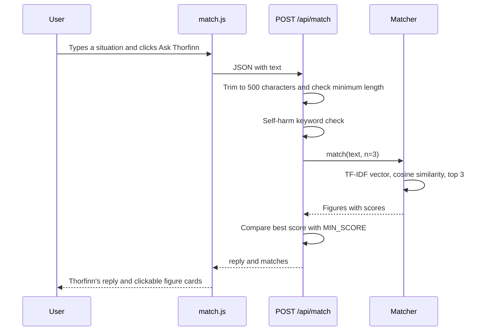
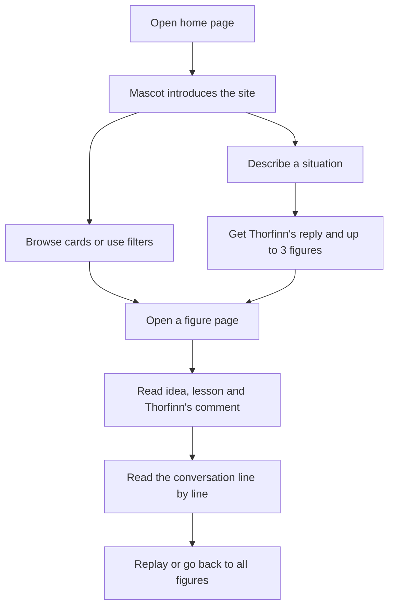
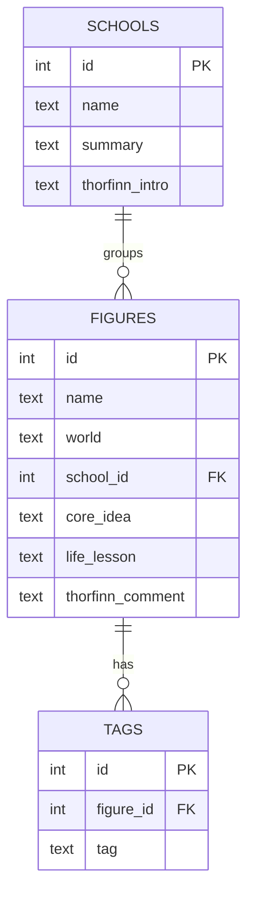

<div align="center">



# Thorfinn's Philosophy Path

**A themed web app where a calm, post-revenge Thorfinn guides you through the ideas of Greek thinkers, modern philosophers and anime characters.**


[Overview](#project-overview) · [Features](#key-features) · [Architecture](#architecture) · [Install](#installation-and-setup) · [Usage](#application-usage-guide) · [Roadmap](#future-development-roadmap)

</div>

> **Fan project notice.** This is a non-commercial learning project. *Vinland Saga* and the other anime series mentioned belong to their creators and publishers, and this project is not affiliated with them. See [Credits and Content Notes](#credits-and-content-notes).

---

## Table of Contents

1. [Project Overview](#project-overview)
2. [Key Features](#key-features)
3. [Screenshots and Demo](#screenshots-and-demo)
4. [Architecture](#architecture)
5. [Technology Stack](#technology-stack)
6. [Project Structure](#project-structure)
7. [Database Design and Data Organization](#database-design-and-data-organization)
8. [Installation and Setup](#installation-and-setup)
9. [Environment Variables and Configuration](#environment-variables-and-configuration)
10. [Application Usage Guide](#application-usage-guide)
11. [AI Integration and Character Interaction](#ai-integration-and-character-interaction)
12. [Design Philosophy and UI/UX](#design-philosophy-and-uiux)
13. [Testing and Troubleshooting](#testing-and-troubleshooting)
14. [Future Development Roadmap](#future-development-roadmap)
15. [Contributing](#contributing)
16. [Credits and Content Notes](#credits-and-content-notes)
17. [License and Author](#license-and-author)

---

## Project Overview

**Thorfinn's Philosophy Path** is a full-stack web application built as a first end-to-end solo project. It covers every layer of a small product: an authored dataset, a relational database, a Flask backend, a themed frontend, a mascot and an information-retrieval feature.

The premise is simple. Thorfinn, from the final arc of *Vinland Saga*, is a warrior who gave up violence and now asks what a good life looks like. In this app he walks beside 23 figures, from Socrates and Marcus-era Stoic ideas to Camus, Itachi Uchiha and Light Yagami, and comments on their ideas from the point of view of someone who once chose revenge.

### Purpose

| Goal | How the project addresses it |
|---|---|
| Learn full-stack development in one project | Dataset, SQLite, Flask routes, Jinja templates, vanilla JavaScript |
| Make philosophy approachable | Every figure has a plain-language idea, a life lesson and a conversation with Thorfinn |
| Connect two worlds | Greek and modern thinkers sit next to anime characters who wrestle with the same questions |
| Practice an explainable "AI" feature | A TF-IDF and cosine-similarity matcher that can be explained line by line |

### Content at a glance

| Item | Count |
|---|---|
| Figures | 23 (7 Anime, 8 Greek, 8 Modern) |
| Schools of thought | 7 |
| Scripted conversations | 23 (4 lines each) |
| Per-figure colour themes | 23, plus one for Thorfinn |

---

## Key Features

### Implemented

| Feature | Description |
|---|---|
| **Figure browser** | A card grid of all 23 figures, each with a coloured top stripe taken from its theme. |
| **Filters** | Filter by world (Anime, Greek, Modern), by school, and by tag. Filters combine, and a reset button clears them. |
| **Per-figure pages** | Each figure has its own page at `/figure/<id>` with a core idea, a life lesson and Thorfinn's comment. |
| **Per-figure themes** | Background, panels, borders, headings and tags change with the figure, driven by CSS variables loaded from `data/themes.json`. |
| **Portraits with fallback** | A portrait is shown when `static/img/<slug>.<ext>` exists. Otherwise the page shows the figure's initials. |
| **Scripted conversations** | A chat-style exchange between Thorfinn and each figure, revealed line by line with a typing indicator, a counter and a replay button. |
| **Thorfinn mascot** | A mascot slides in with a speech bubble, Next and Skip buttons, and can be clicked to replay. The home page and each figure page have their own lines. |
| **Situation matcher** | A text box where you describe a situation. The app returns up to three matching figures and a reply written from the dataset. |
| **Safeguard message** | If the text contains a sign of self-harm, the matcher shows a supportive message instead of a philosophy match. |
| **JSON API** | Read-only endpoints for schools, figures, a single figure and a dialogue, plus a `POST` endpoint for matching. |
| **Data validation and helper tools** | Scripts to validate the dataset, test the database, resize portraits, rename images and convert dialogue files. |

### Planned (not implemented yet)

See the [roadmap](#future-development-roadmap). In particular, **LLM-powered chat is not implemented**. All conversations are scripted, and the matcher uses classical text statistics rather than a language model.

---

## Screenshots and Demo

### Existing assets

A few portraits and the mascot already in the repository (AI-generated illustrations, see [Credits](#credits-and-content-notes)):

<div align="center">

| Thorfinn (mascot) | Socrates | Plato | Albert Camus |
|:---:|:---:|:---:|:---:|
|  |  |  |  |

</div>

### Page screenshots

<!--
SCREENSHOTS: add your own images to docs/screenshots/ and uncomment this block.

| Home page | Character page | Situation matcher |
|:---:|:---:|:---:|
|  |  |  |
-->

Screenshots of the home page, a themed character page and the situation matcher will be added here. To see the app now, follow [Installation and Setup](#installation-and-setup). It runs locally in a minute.

---

## Architecture

The app is a small server-rendered Flask application. Page routes render Jinja templates, and the browser then calls JSON routes with `fetch` to load cards and run the matcher.

### System overview



### Data pipeline

The JSON files are the source of truth. The database is generated from them, which is why it is not committed.



### Situation matching flow



### User journey



---

## Technology Stack

Exact pinned versions are recorded in `requirements.txt`. To list what is installed in your environment:

```bash
pip list
```

| Layer | Technology | Used for |
|---|---|---|
| Language | Python 3 | Backend, data scripts, matcher |
| Web framework | Flask (with Jinja2 templating) | Routes, JSON API, server-rendered pages |
| Database | SQLite through Python's built-in `sqlite3` module | Schools, figures and tags |
| Machine learning | scikit-learn (`TfidfVectorizer`, `cosine_similarity`) | Situation matching |
| Image tooling | Pillow | `tools/` scripts and the mascot script only, not needed to run the app |
| Frontend | HTML5, CSS3 (custom properties, grid, flexbox, `color-mix`), vanilla JavaScript | UI, themes, filters, chat, mascot |
| Data format | JSON | Dataset, themes and dialogues |
| Version control | Git and GitHub | Source hosting |

**Browser support note:** per-figure transparency effects use the CSS `color-mix()` function, which needs a recent browser (Chrome 111+, Firefox 113+, Safari 16.2+).

---

## Project Structure

```text
Thorfinn-Philosophy/
├── app.py                  Flask app: page routes, JSON API, match endpoint
├── matcher.py              TF-IDF matcher used by /api/match
├── db_setup.py             Builds data/philosophy.db from data/figures.json
├── check_data.py           Validates the dataset and themes
├── test_db.py              Sample SQL queries to confirm the database works
├── requirements.txt        Python dependencies
├── README.md               This file
├── CREDITS.md              Image and content credits
├── .gitignore              Keeps the virtual environment, database and raw images out of git
│
├── data/
│   ├── figures.json        Source data: 7 schools and 23 figures
│   ├── themes.json         Colour theme for each figure, plus "_thorfinn"
│   ├── dialogues.json      Conversations keyed by figure name
│   └── philosophy.db       Generated by db_setup.py (not committed)
│
├── templates/
│   ├── index.html          Home page: header, matcher, filters, card grid, mascot
│   └── figure.html         Figure page: portrait, panels, conversation, mascot
│
├── static/
│   ├── style.css           Home page styles
│   ├── figure.css          Figure page styles, chat bubbles, themes
│   ├── mascot.css          Mascot bubble and avatar styles
│   ├── script.js           Loads schools and figures, applies filters, builds cards
│   ├── match.js            Sends the situation text and renders matches
│   ├── chat.js             Reveals the conversation line by line
│   ├── mascot.js           Mascot lines, Next and Skip, replay on click
│   └── img/
│       ├── <figure-slug>.jpg   Portraits (e.g. socrates.jpg)
│       ├── thorfinn.png, thorfinn.svg, thorfinn-original.png
│       └── make_mascot.py      Script used to prepare the mascot image
│
└── tools/                  One-off helper scripts
    ├── resize_images.py        Crops portraits to a 4:5 ratio into static/img
    ├── check_images.py         Reports which figures have portraits
    ├── rename_images.py        Renames downloaded images to the expected slugs
    └── convert_dialogues.py    Groups a flat dialogue list into dialogues.json
```

Local-only folders such as `venv/`, `.venv/` and `raw_images/` are intentionally not part of the repository.

### Route reference

| Method | Route | Purpose |
|---|---|---|
| GET | `/` | Home page |
| GET | `/figure/<id>` | Themed figure page with conversation (404 if the id does not exist) |
| GET | `/api/schools` | All schools |
| GET | `/api/figures` | All figures, with optional `school`, `world` and `tag` query parameters |
| GET | `/api/figures/<id>` | One figure, including tags, theme and school intro |
| GET | `/api/dialogue/<id>` | The conversation for one figure |
| POST | `/api/match` | Match a situation to figures. Body: `{"text": "..."}` |

Examples (Git Bash):

```bash
curl "http://127.0.0.1:5000/api/figures?world=Anime"
curl "http://127.0.0.1:5000/api/figures?tag=freedom"
curl "http://127.0.0.1:5000/api/figures?school=Existentialism"
curl -X POST http://127.0.0.1:5000/api/match \
     -H "Content-Type: application/json" \
     -d '{"text": "I want revenge on someone who hurt me"}'
```

---

## Database Design and Data Organization

### Entity relationship diagram



`db_setup.py` deletes and rebuilds `data/philosophy.db` every time it runs, so editing the JSON and re-running the script is always safe.

### Data files

| File | Contents | Key fields |
|---|---|---|
| `data/figures.json` | `schools` and `figures` lists | Figure: `name`, `world`, `school`, `core_idea`, `life_lesson`, `thorfinn_comment`, `tags`. School: `name`, `summary`, `thorfinn_intro` |
| `data/themes.json` | One entry per figure name, plus `_thorfinn` | `bg`, `surface`, `primary`, `highlight`, `accent` |
| `data/dialogues.json` | Figure name mapped to a list of lines | `speaker`, `text` |

Conventions the code relies on:

- A figure's `school` must match a school `name` exactly.
- `world` is one of `Anime`, `Greek` or `Modern`.
- Figure names must be identical across `figures.json`, `themes.json` and `dialogues.json`.
- Portrait files are named by slug: lowercase, hyphens instead of spaces, accents removed. For example `Søren Kierkegaard` becomes `soren-kierkegaard.jpg`.

### Schools and figures

| School | Figures |
|---|---|
| Stoicism & Self-Mastery | Zeno of Citium, Heraclitus, Pythagoras, Miyamoto Musashi |
| Virtue & Reason | Socrates, Plato, Aristotle |
| Simple Living | Epicurus, Diogenes of Sinope |
| Utilitarianism & Duty | John Stuart Mill, Immanuel Kant, Lelouch vi Britannia, Itachi Uchiha |
| Existentialism | Jean-Paul Sartre, Søren Kierkegaard, Friedrich Nietzsche, Guts, Eren Yeager |
| Nihilism & Absurdism | Albert Camus, Johan Liebert |
| Justice, Power & Peace | Light Yagami, Hannah Arendt, Simone Weil |

Grouping figures into schools is a judgment call. Some placements are debatable, and they are easy to change in `figures.json`.

### Theme roles

Each theme has five colours, each with one job:

| Key | Role |
|---|---|
| `bg` | Page background |
| `surface` | Panels and cards |
| `primary` | Decorative fills such as the portrait frame and gradients. Never used for text. |
| `highlight` | The figure's identity colour for headings, borders and tags |
| `accent` | A small secondary touch such as the quote bar |

---

## Installation and Setup

### Prerequisites

- Python 3 (check with `python --version`)
- Git
- A recent browser (see [browser support](#technology-stack))

### Windows with Git Bash

```bash
git clone https://github.com/SohailAbbasPitafi/Thorfinn-Philosophy.git
cd Thorfinn-Philosophy

python -m venv venv
source venv/Scripts/activate

pip install -r requirements.txt
python db_setup.py
python app.py
```

Open **http://127.0.0.1:5000/** in your browser. Stop the server with `Ctrl + C`.

### Windows PowerShell

```powershell
git clone https://github.com/SohailAbbasPitafi/Thorfinn-Philosophy.git
cd Thorfinn-Philosophy

python -m venv venv
venv\Scripts\Activate.ps1

pip install -r requirements.txt
python db_setup.py
python app.py
```

If PowerShell blocks the activation script, run `Set-ExecutionPolicy -Scope Process RemoteSigned` first.

### Windows Command Prompt

```bat
python -m venv venv
venv\Scripts\activate.bat
pip install -r requirements.txt
python db_setup.py
python app.py
```

### macOS or Linux

The same steps should work with `source venv/bin/activate` instead of the Windows activation line. This path has not been tested by the author.

### Expected output

`python db_setup.py` should print:

```text
Database built: 7 schools, 23 figures
```

### Optional: helper scripts

The `tools/` scripts need Pillow, which the app itself does not:

```bash
pip install pillow
```

---

## Environment Variables and Configuration

**No environment variables are required.** The app has no API keys, no `.env` file and no external services. It runs fully offline.

Configuration lives as constants in `app.py`:

| Constant | Default | Meaning |
|---|---|---|
| `DB_PATH` | `data/philosophy.db` | SQLite database location |
| `THEMES_PATH` | `data/themes.json` | Colour themes |
| `DIALOGUES_PATH` | `data/dialogues.json` | Conversations |
| `IMAGE_EXTENSIONS` | `jpg, jpeg, png, webp, svg` | Extensions checked for portraits, in this order |
| `MIN_SCORE` | `0.04` | Minimum similarity for the matcher to answer instead of saying it is unsure |
| `CRISIS_WORDS` | a short keyword list | Phrases that trigger the supportive safeguard message |

Other things to know:

- The app starts with `app.run(debug=True)`. This is Flask's development server and is **not suitable for production**.
- Paths are relative, so run commands from the project root.
- `dialogues.json`, `themes.json` and the database are read when the server starts. **Restart the server after editing them.**

---

## Application Usage Guide

### Browse and filter

1. Open the home page. Thorfinn introduces the site.
2. Use the **world** dropdown, the **school** dropdown or the **tag** box. They can be combined.
3. Click **Reset** to clear all filters.
4. Click any card to open that figure's page.

### Read a figure page

Each page shows:

1. A portrait (or initials) in a frame tinted with the figure's colour.
2. The core idea, the life lesson and Thorfinn's comment.
3. A conversation. The first line appears immediately. Click **Continue** to see a typing indicator and the next line. A counter shows progress, and **Replay** appears at the end.

### Mascot behaviour

| Where | Plays | Replay |
|---|---|---|
| Home page | Once per browser (remembered in `localStorage`) | Click Thorfinn |
| Figure page | Once per figure per tab session (`sessionStorage`) | Click Thorfinn |

To see the intro again while testing, run this in the browser console (`F12`):

```javascript
localStorage.clear(); sessionStorage.clear();
```

### Describe a situation

1. Type a sentence or two into **Tell Thorfinn your situation** (5 to 500 characters).
2. Click **Ask Thorfinn**, or press `Ctrl + Enter` inside the box.
3. Read Thorfinn's reply and click a suggested figure to open their page.

Example inputs:

- `I want revenge on someone who hurt me`
- `I feel like nothing matters anymore`
- `I just follow orders at work without thinking`
- `I am scared to change my life`

### Add a new figure

1. Add the figure to `data/figures.json`, using an existing school name and a valid world.
2. Add a matching entry in `data/themes.json` under the same name.
3. Add a conversation in `data/dialogues.json` under the same name.
4. Save a portrait as `static/img/<slug>.jpg` (optional, initials are used otherwise).
5. Run `python check_data.py`, then `python db_setup.py`, then restart `python app.py`.

---

## AI Integration and Character Interaction

### What is implemented

The "AI" in this project is **classical information retrieval**, not a language model. It is deliberate: every step can be explained and reproduced without an API key.

**How the matcher works** (`matcher.py`):

1. Each figure becomes one text document built from: tags (included twice so they weigh more), core idea, life lesson, Thorfinn's comment, the school summary and the lines of the figure's conversation.
2. `TfidfVectorizer(stop_words="english", sublinear_tf=True)` turns every document into a vector. Words that are rare across figures, such as "revenge", get more weight than common words.
3. The user's sentence is transformed with the same vectorizer.
4. `cosine_similarity` ranks all figures against the sentence, and the top three with a score above zero are returned.
5. In `app.py`, if the best score is below `MIN_SCORE`, Thorfinn says he is not sure instead of guessing.
6. Thorfinn's reply is **assembled from the dataset text**: the best match's `thorfinn_comment`, followed by the second match's `life_lesson` when there is one.

**Character interaction** is scripted: `data/dialogues.json` holds a short exchange between Thorfinn and each figure, and `chat.js` reveals it with a typing indicator.

### Safeguard

Because the box invites personal input, `/api/match` checks for a short list of self-harm phrases before matching. If one is found, it returns a supportive message encouraging the user to contact someone they trust or a local emergency or crisis service. This is a simple keyword check, **not** a safety system, and it is not a replacement for professional help.

### Limitations

- TF-IDF matches **words, not meaning**. A sentence that shares no vocabulary with the dataset may match poorly or return the "not sure" reply.
- The matcher only knows the English text in the dataset.
- `MIN_SCORE` was chosen by hand and may need tuning.
- Conversations are fixed scripts. Users cannot ask a figure a question.
- Matcher results and Thorfinn's replies are only as good as the dataset text.

---

## Design Philosophy and UI/UX

| Decision | Reasoning |
|---|---|
| **Dark, contemplative base** | Deep charcoal backgrounds and parchment-coloured text suit the calm, reflective tone of the subject. |
| **One identity colour per figure** | A figure's colour (the `highlight`) carries their page. Saturated colour is limited to small elements so the site stays unified. |
| **Role-based colours** | Decorative `primary` fills never carry text. Text-bearing colours are separate, so readability does not depend on the decorative palette. |
| **Contrast checked during development** | Highlight colours were tuned to reach at least a 4.5:1 contrast ratio against each figure's panel colour. This was computed with a script while building and is not an automated test in the repository. |
| **Thorfinn's voice** | Short, plain, calm sentences. He questions and reflects rather than lectures. |
| **Progressive reveal** | The conversation shows its first line immediately and then one line per click, so it reads like a dialogue rather than a wall of text. |
| **Graceful fallbacks** | No portrait: initials. No `thorfinn.png`: the SVG avatar. No dialogue: a placeholder message. |
| **Responsive layout** | The card grid adapts to screen width, and the figure page stacks on narrow screens. |
| **Safe text rendering** | Cards are built with `textContent` rather than `innerHTML`, and Jinja escapes template values. |

---

## Testing and Troubleshooting

### Testing

There is **no automated test suite** (no pytest or unit tests) at the moment. Verification is done with scripts and manual checks.

| Command | What it checks | Expected result |
|---|---|---|
| `python check_data.py` | Schools, worlds and figure counts in `figures.json`; themes for every figure | `7 schools, 23 figures` with no "Unknown school", "Bad world" or "No theme" lines |
| `python db_setup.py` | Builds the database | `Database built: 7 schools, 23 figures` |
| `python test_db.py` | Joins and tag queries | Figures grouped by school, then the figures tagged `freedom` |
| `python tools/check_images.py` | Which figures have portraits | An OK or MISSING line per figure |
| `python tools/convert_dialogues.py` | Dialogue grouping and name matching | 23 conversations, `Missing: []`, `Wrong key: []` |

Manual checks:

- [ ] Home page loads, cards show, all three filters work, Reset works
- [ ] A figure page shows its theme, portrait or initials, and a working conversation
- [ ] The mascot appears on first visit and replays when clicked
- [ ] The situation box returns figures for sample sentences and the "not sure" reply for gibberish
- [ ] `http://127.0.0.1:5000/figure/999` returns a 404

### Troubleshooting

| Problem | Likely cause | Fix |
|---|---|---|
| `FileNotFoundError: data/dialogues.json` | The converted dialogue file has not been created | Run `python tools/convert_dialogues.py` (needs `data/dialogues_raw.json`) |
| `no such table` or an empty site | The database has not been built | Run `python db_setup.py`, then restart the app |
| Edited data does not appear | Data is loaded at startup | Restart `python app.py` |
| Portrait still shows initials | The file name does not match the slug, or the file is in the wrong folder | Check `static/img/<slug>.jpg`, run `python tools/check_images.py`, then hard refresh with `Ctrl + F5` |
| Old CSS or JavaScript after an edit | Browser cache | Hard refresh with `Ctrl + F5` |
| Mascot does not replay | Seen-flag stored in the browser | Clear `localStorage` and `sessionStorage` in the console |
| `ModuleNotFoundError` | Virtual environment not active or dependencies missing | Activate `venv`, then `pip install -r requirements.txt` |
| `Address already in use` | Another copy of the server is running | Stop it with `Ctrl + C`, or close the other terminal |
| `import flask could not be resolved` in VS Code | VS Code is using a different Python interpreter | `Ctrl + Shift + P`, then `Python: Select Interpreter`, then pick the one inside `venv` |
| Red squiggles on `{{ ... }}` inside a `style` or `onerror` attribute | VS Code reads Jinja placeholders as CSS or JavaScript | Cosmetic only, the page works. The templates avoid most of these by passing values through CSS variables and `data-` attributes |

---

## Future Development Roadmap

### Short term

- [ ] Add screenshots to this README
- [ ] Rewrite remaining draft dataset and dialogue lines in the author's own words
- [ ] Add a portrait for the figures that still use initials
- [ ] Tune `MIN_SCORE` using a documented set of test sentences
- [ ] Remove the leftover popup code from the home page, since cards now open full pages
- [ ] Choose and add a `LICENSE` file

### Medium term

- [ ] Add more figures and schools, for example Nagato (Pain), Franz Kafka and Arthur Schopenhauer
- [ ] Add automated tests (pytest) for the API routes and the matcher
- [ ] Improve matching with sentence embeddings
- [ ] Add search by figure name
- [ ] Add a `requirements-dev.txt` for the image tools

### Long term

- [ ] LLM-powered chat where users can ask a figure a question, with API keys stored in environment variables and never in the repository
- [ ] Deployment to a hosting service with a production server
- [ ] Multiple branching dialogue paths per figure

Items above are ideas. None of them are implemented yet.

---

## Contributing

Contributions, corrections and ideas are welcome, especially around accuracy of the philosophy summaries.

1. Fork the repository and create a branch: `git checkout -b feature/your-change`
2. Make your change and run the checks in [Testing](#testing-and-troubleshooting)
3. Commit with a clear message and open a pull request describing what changed and why

Content guidelines:

- Keep summaries accurate and simple. Do not attribute beliefs to a thinker that they did not hold.
- Write all lessons, comments and dialogue in original wording. Do not copy dialogue from anime, manga, books or other sources.
- Keep Thorfinn calm, humble and reflective.
- Do not add official artwork or screenshots. Only add images you have the right to publish, and describe them in `CREDITS.md`.
- Keep names identical across `figures.json`, `themes.json` and `dialogues.json`.

---

## Credits and Content Notes

- **Fan project.** *Vinland Saga*, *Naruto*, *Death Note*, *Code Geass*, *Attack on Titan*, *Berserk*, *Monster* and other works referenced belong to their creators and publishers. This project is non-commercial, educational and unaffiliated.
- **Images.** Portraits and the Thorfinn mascot are AI-generated illustrations created with ChatGPT's image generation. They are not photographs or historical portraits. Anime characters and the mascot are fan depictions of characters owned by their creators. See [`CREDITS.md`](CREDITS.md).
- **AI assistance.** First drafts of the dataset and the dialogues were produced with AI assistance and are being reviewed and rewritten by the author. Philosophical summaries are simplified for a general audience and are not scholarly sources.
- **Philosophers and ideas.** The thinkers named are historical figures, and their ideas are summarized, not quoted at length.

---

## License and Author

**License:** no license file has been added yet, so default copyright applies and the code is not yet licensed for reuse. A license will be chosen and added before encouraging reuse. Content related to third-party characters and AI-generated images may carry separate restrictions regardless of the code license.

**Author:** [@SohailAbbasPitafi](https://github.com/SohailAbbasPitafi)

**Repository:** [github.com/SohailAbbasPitafi/Thorfinn-Philosophy](https://github.com/SohailAbbasPitafi/Thorfinn-Philosophy)

<div align="center">

*Built as a first end-to-end project. Questions and corrections are welcome through GitHub issues.*

</div>